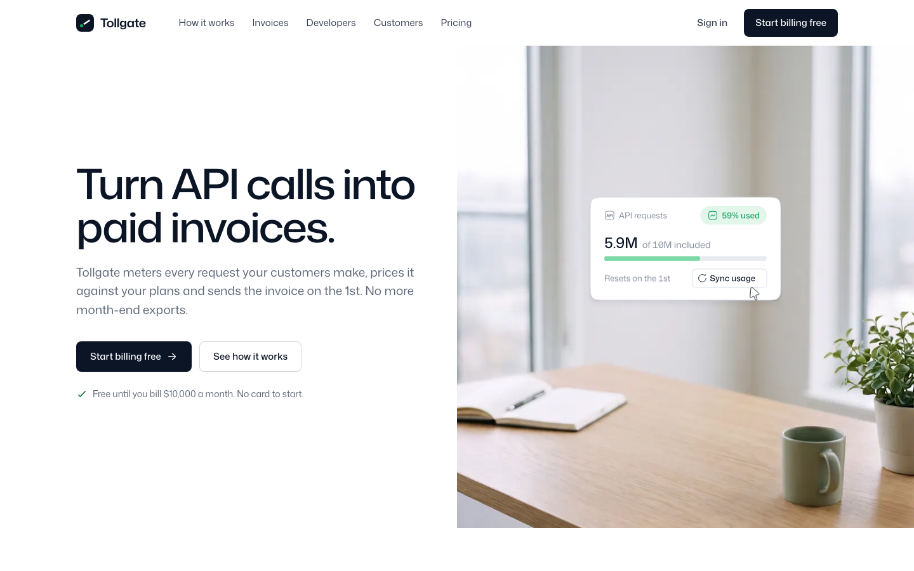

# Tollgate

A free landing page template for a made-up product called Tollgate, metered billing and invoices for API products. It is illustrated with six animated assets by [Illos](https://illos.dev), drawn in the Illos Interface style and lettered in the page's own font, Mona Sans.

[](https://vercel.com/new/clone?repository-url=https%3A%2F%2Fgithub.com%2Fnavedux%2Fillos-tollgate-template)

Live demo: https://illos-tollgate-template.vercel.app



The page opens with the copy on the left and a desk photo on the right with a live usage meter floating on it. Then a three-step "Meter, price, invoice" band, an estimate you can play with (pick a plan, drag the month's requests, and the invoice works itself out), a developer section with code tabs and an API key, a finance controls section on a team photo, customer quotes, pricing with add-ons joined under the plans, questions, and a closing call to action.

Tollgate is not a real company, and every person, company and figure on the page is made up. Change the name, the copy and the numbers to your own.

## Run it

You need Node 18 or later.

```
npm install
npm run dev
```

Then open the address Vite prints (the dev script uses port 4875).

## Build it

```
npm run build
```

The finished site goes to `dist/`. It is plain HTML, CSS and JavaScript, so any static host can serve it. `npm run preview` serves `dist/` locally so you can check the build.

## Edit it

- `index.html` holds the page and all its copy.
- `src/style.css` holds the styles. Colours, radii, the shadow and the section spacing are CSS variables at the top.
- `src/main.js` plays the animated assets while they are on screen, runs the mobile menu, the estimate, the code tabs and the copy button.
- `illos/` holds the animated assets as SVG files.
- `public/` holds the fonts (Mona Sans and Geist Mono, self-hosted), the photos and the favicon.

Each animated asset sits in the page as a comment such as `<!-- illos:tollgate-usage-meter -->`. The build swaps the comment for the SVG inline, so the asset can read the page's colours. To move one, move its comment. To use another, drop its SVG into `illos/` and add a comment with its file name.

The assets take their colours from the `--illos-*` variables in `src/style.css`. Change `--accent` and the highlights in every asset follow, along with the page's own.

### The estimate

The plans, their included requests, their prices per 1,000 requests past that and the tax rate are at the top of the estimate block in `src/main.js` (`PLANS` and `TAX`). The slider runs from 100K to 200M requests on a log scale. When another plan would be cheaper for the chosen usage, the invoice says so and offers to switch.

## How the motion behaves

- Each animated asset loops while it is on screen and pauses when it scrolls away.
- With reduced motion turned on in the system settings, every asset shows one still frame.
- Nothing else on the page moves on its own: no scroll effects, no carousels.

## Fonts and photos

Mona Sans (variable, with its width axis for the headings) and Geist Mono are self-hosted in `public/fonts`, under the SIL Open Font License (the licence files sit beside them). The two photos in `public/img` were generated for this template and are free to use with it.

## Licence

The code is MIT. The illustrations are free to use in sites you build from this template, but not to redistribute on their own. See `LICENSE.md`.

## More illustrations

The animated assets come from [Illos](https://illos.dev), where there are more in the same style, along with the skills that let your coding agent make new ones in your product's own font and corners.
